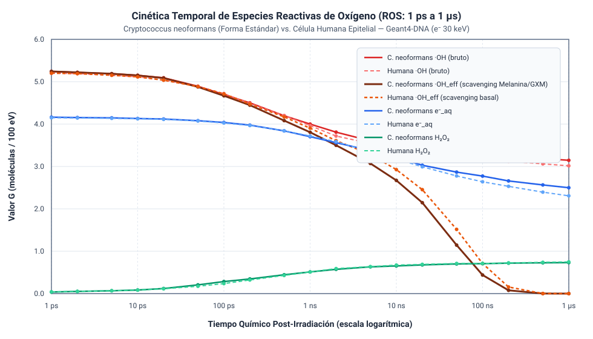
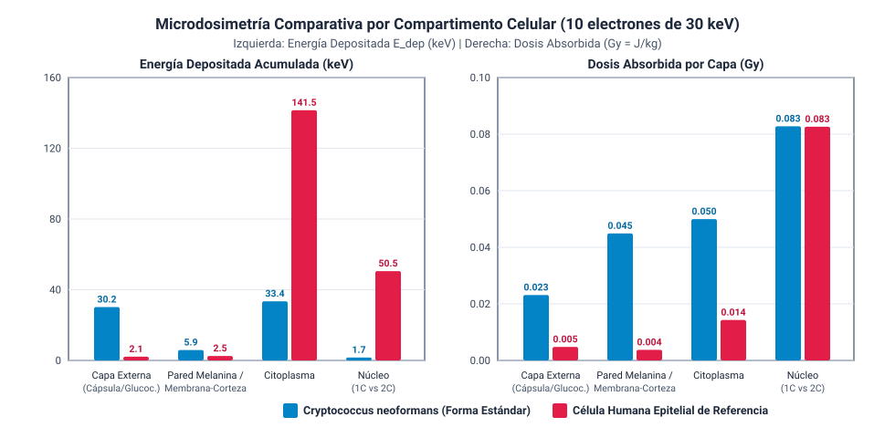

# CryptoRadG4DNA: Microdosimetría y Cinética de ROS en *Cryptococcus neoformans* vs. Célula Humana Epitelial

Simulación Monte Carlo en **C++17** con **Geant4-DNA (v11.2+)** para evaluar y comparar cuantitativamente la deposición de microdosis por compartimento subcelular y la generación/difusión temporal de Especies Reactivas de Oxígeno (**ROS**: $\cdot\text{OH}$, $e^-_{\text{aq}}$, $\text{H}_2\text{O}_2$ desde $1\text{ ps}$ hasta $1\ \mu\text{s}$) entre:

1. **Célula fúngica patógena *Cryptococcus neoformans* (Forma Estándar / Levadura Típica *In Vitro*):**
   - **Cápsula Polisacárida Externa ($1.2\ \mu\text{m}$):** ~99% agua + matriz polisacárida (89% Glucuronoxilomanano - GXM, 9% Galactoxilomanano - GalXM, 2% Manoproteínas).
   - **Pared Celular Melaninizada ($150\text{ nm}$):** Quitosano, quitina, $\alpha/\beta$-glucanos y pigmento antioxidante de **melanina** (indol-5,6-quinona).
   - **Citoplasma y Membrana (Ergosterol):** Diámetro de cuerpo celular de $6.0\ \mu\text{m}$ (relación de aspecto $1.10$).
   - **Núcleo Haploide ($1\text{C}$):** Radio de $0.9\ \mu\text{m}$.

2. **Célula Humana Epitelial de Referencia (Cúbica Polarizada):**
   - **Glucocáliz Externo ($80\text{ nm}$):** Cubierta hidratada rica en ácido siálico y glucoproteínas.
   - **Complejo Membrana-Corteza ($120\text{ nm}$):** Bicapa con 25% de colesterol, esfingolípidos y corteza de actina/citoqueratinas.
   - **Citoplasma Polarizado:** Geometría cúbica ($12\ \mu\text{m} \times 12\ \mu\text{m} \times 12\ \mu\text{m}$, $V = 1,728\ \mu\text{m}^3$).
   - **Núcleo Diploide ($2\text{C}$):** Radio de $2.8\ \mu\text{m}$.

---

## Resultados Gráficos Comparativos (Electrones de $30\text{ keV}$)

### 1. Cinética Temporal de ROS ($1\text{ ps}$ a $1\ \mu\text{s}$)


### 2. Microdosimetría por Compartimento Celular ($E_{\text{dep}}$ y Dosis en $\text{Gy}$)


---

## Estructura del Repositorio

```text
├── CMakeLists.txt                  # Configuración de compilación con CMake y Geant4 11+
├── main.cc                         # Punto de entrada (modo interactivo Qt/OpenGL y modo batch)
├── include/                        # Cabeceras C++17 (.hh)
│   ├── DetectorConstruction.hh     # Geometría multicapa y materiales bioquímicos acoplados a G4_WATER
│   ├── DetectorMessenger.hh        # Comandos UI (/cell/...) para parametrizar corridas
│   ├── PhysicsList.hh              # Física G4EmDNAPhysics_option2/option8 + G4EmDNAChemistry_option3
│   ├── ActionInitialization.hh     # Registro de acciones y configuración de G4Scheduler
│   ├── PrimaryGeneratorAction.hh   # Fuente primaria y microhaz circular (/beam/...)
│   ├── StackingAction.hh           # Disparo de radiólisis al concluir trazas físicas
│   ├── RunAction.hh                # Exportación de Ntuples CSV mediante G4AnalysisManager
│   ├── EventAction.hh              # Cálculo de dosis (Gy) por evento y capa celular
│   ├── SteppingAction.hh           # Scoring espacial de energía depositada
│   └── TimeStepAction.hh           # Seguimiento IRT de ·OH, e-_aq, H2O2 y scavenging (1 ps a 1 us)
├── src/                            # Implementaciones (.cc)
├── macros/                         # Scripts de control de Geant4 (.mac)
│   ├── vis.mac                     # Visualización 3D interactiva
│   ├── run_cryptococcus.mac        # Simulación en C. neoformans (forma estándar)
│   └── run_human_epithelial.mac    # Simulación en célula epitelial humana
└── analysis/                       # Post-procesamiento y gráficas
    ├── compare_results.py          # Resumen estadístico en terminal de los CSVs
    ├── plot_results.py             # Generador de gráficas vectoriales SVG
    ├── ros_kinetics_comparison.svg
    └── layer_dosimetry_comparison.svg
```

---

## Compilación y Ejecución

```bash
mkdir -p build && cd build
cmake ..
cmake --build . -j 8

# Ejecutar simulaciones en modo batch
./crypto_rad_sim run_cryptococcus.mac
./crypto_rad_sim run_human_epithelial.mac

# Analizar CSVs y regenerar gráficas comparativas
python3 ../analysis/compare_results.py ..
python3 ../analysis/plot_results.py
```
